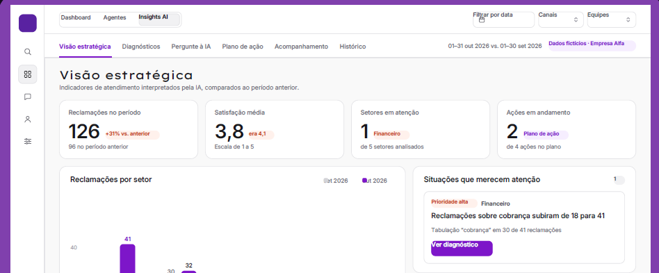
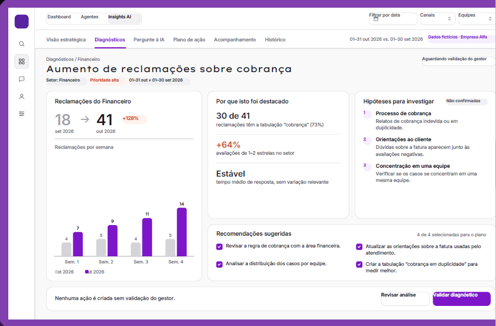
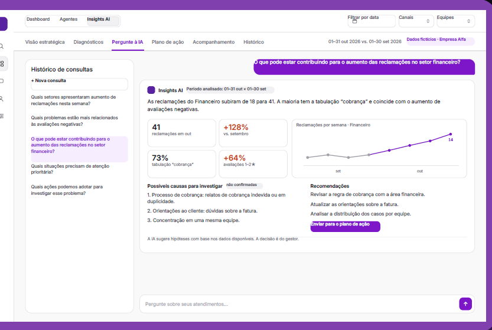
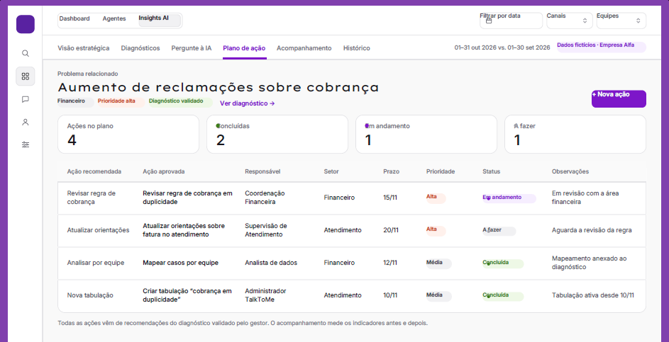

# TalkToMe Insights AI

**Inteligência de atendimento para decisões estratégicas.**

Uma proposta de módulo de inteligência artificial para transformar dados de atendimento em diagnósticos, recomendações e planos de ação, apoiando gestores na tomada de decisões.

## Sobre o projeto

O TalkToMe Insights AI surgiu da proposta de ampliar as possibilidades de análise dos dados de atendimento, permitindo que gestores identifiquem problemas, compreendam tendências e acompanhem ações de melhoria em um mesmo ambiente.

A solução propõe uma camada de inteligência sobre os recursos existentes do TalkToMe, utilizando inteligência artificial para interpretar indicadores e apoiar a análise estratégica.

**Status:** Prototipação e planejamento técnico.

> Este repositório documenta a proposta e o protótipo conceitual. As funcionalidades descritas são planejadas e não representam uma integração ou implementação já concluída.

## Problema identificado

Os dados de atendimento existem, mas muitas vezes dependem de análise manual para se transformarem em decisões estratégicas.

Entre os desafios identificados estão:

- Reclamações distribuídas entre diferentes setores.
- Indicadores que precisam ser analisados manualmente.
- Dificuldade para identificar padrões e tendências.
- Ações sem acompanhamento conectado ao diagnóstico.

## Objetivo

Transformar dados de atendimento em diagnóstico e decisão estratégica, com acompanhamento das ações.

## Solução proposta

O Insights AI propõe um módulo integrado ao dashboard do TalkToMe, com recursos de análise inteligente, diagnóstico preventivo e acompanhamento de planos de ação.

### Principais funcionalidades propostas

1. **Dashboard estratégico:** visualização dos indicadores de atendimento.
2. **Análise de reclamações:** identificação de setores com maior concentração de problemas.
3. **Identificação de tendências:** comparação de períodos e reconhecimento de padrões.
4. **Diagnóstico preventivo:** apresentação de evidências e hipóteses para investigação.
5. **IA conversacional:** consultas sobre os dados utilizando linguagem natural.
6. **Recomendações:** sugestões de prevenção e melhoria.
7. **Plano de ação:** organização de ações, responsáveis, prazos e prioridades.
8. **Acompanhamento:** análise dos resultados antes e depois das ações.
9. **Histórico:** consulta aos diagnósticos e às ações anteriores.

## Público beneficiado

- Gestores.
- Administradores.
- Supervisores.
- Coordenadores.
- Equipes de atendimento.
- Clientes, de forma indireta.

## Tecnologias e recursos previstos

Os recursos considerados no planejamento incluem:

- Inteligência Artificial.
- APIs e integrações autorizadas.
- Dashboard.
- Dados de atendimento.
- Motor analítico.
- Histórico de diagnósticos.
- Plano de ação.

A arquitetura e as tecnologias específicas ainda dependem de validação técnica.

## Segurança e confiabilidade

A proposta considera cuidados importantes para o uso responsável dos dados:

- Sinalização de dados incompletos.
- Exibição de evidências que sustentem os diagnósticos.
- Validação das interpretações pelo gestor.
- Proteção de dados e privacidade.
- Utilização de dados agregados e anonimizados.
- Respeito às permissões existentes no TalkToMe.

## Resultados esperados

- Identificação mais rápida de problemas.
- Melhor compreensão das reclamações.
- Apoio à tomada de decisões.
- Acompanhamento das ações de melhoria.
- Melhor experiência do cliente.

Os resultados ainda precisam ser validados durante as próximas etapas do projeto.

## Próximas etapas

O planejamento prevê a seguinte evolução:

1. Protótipo.
2. Validação.
3. Desenvolvimento do MVP.
4. Integração.
5. Testes.
6. Evolução.

## Documentação visual

## 🖥️ Telas do protótipo

### 1. Dashboard estratégico

Visão geral dos indicadores de atendimento, reclamações e setores que precisam de atenção.

### 2. Diagnóstico preventivo

Análise de evidências, identificação de tendências e hipóteses para investigação.

### 3. Inteligência artificial conversacional

Interface conceitual para realizar perguntas sobre os dados de atendimento e receber análises da IA.

### 4. Plano de ação

Organização das recomendações aprovadas, responsáveis, prazos e acompanhamento das ações.

## Autoria

Projeto desenvolvido por [ana-julia-an](https://github.com/ana-julia-an), no contexto de planejamento e prototipação de uma solução de inteligência artificial aplicada ao atendimento ao cliente.
